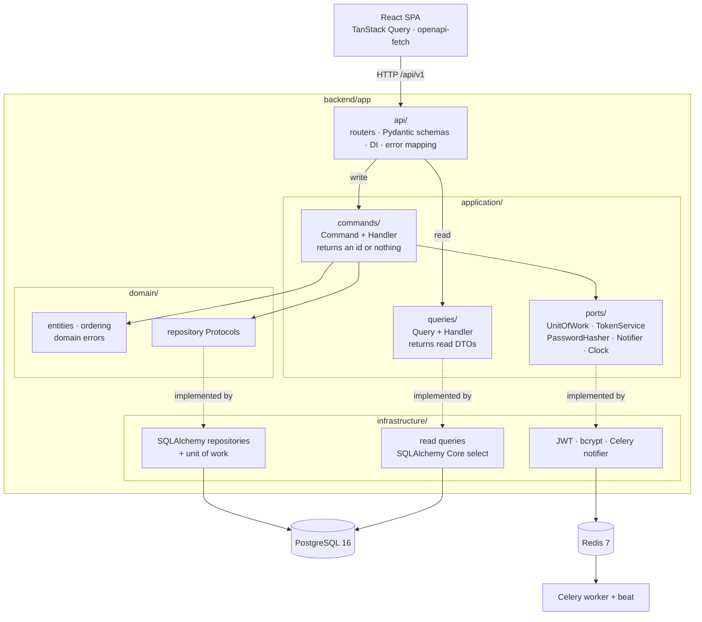

<!-- TODO: replace OWNER/REPO with the GitHub repository path once the remote exists. -->
[](https://github.com/OWNER/REPO/actions/workflows/ci.yml)
[](https://github.com/OWNER/REPO/actions/workflows/codeql.yml)

# Trello Light

A Trello-like Kanban task manager: a FastAPI backend (Clean Architecture with lightweight CQRS)
and a React SPA with drag-and-drop columns, task assignment and filtering.

## User story

> As a team member, I want to sign in and see our work as a board of columns, so that I can
> create, edit and delete tasks, drag them between columns (moving one into a "done" column marks
> it completed), add new columns, assign tasks to people, and filter the board to what I care
> about.

What it does:

- Email and password sign-in with short-lived JWT access tokens and single-use refresh tokens.
  Signing out revokes the session on the server.
- One shared board: columns (statuses) with drag-and-drop ordering, one or more `is_done` columns.
- Tasks with a title, description, assignee and due date, reordered by drag and drop within and
  across columns. `completed_at` is set and cleared automatically.
- Filters by column, assignee, due date range, completion and title search, on the board and on a
  paginated task list.
- Background jobs (Celery): an email to the assignee when a task is assigned, and a daily digest of
  tasks due soon. Emails are logged to the console in this exercise.

## Architecture



- **Dependencies point inward.** `domain` imports nothing from FastAPI, SQLAlchemy, Pydantic or
  other layers. `application` imports only `domain` and its own `ports`.
- **Commands** (writes) load domain entities through repositories, apply the rules on the
  entities, and commit through the unit of work.
- **Queries** (reads) skip the domain: they select only the columns a screen needs straight into
  read DTOs. The board query runs exactly two SQL statements, whatever the board size.
- Same database for reads and writes. No event sourcing, no message bus.
- Domain errors (`TaskNotFound`, `StatusHasTasks`, `StaleOrdering`, …) are mapped to HTTP
  responses in one place: `backend/app/api/errors.py`.

| Path        | What                                                                        |
| ----------- | --------------------------------------------------------------------------- |
| `backend/`  | FastAPI, SQLAlchemy 2 (async), Alembic, Celery. Tooling: uv, ruff, mypy     |
| `frontend/` | Vite, React 19, TypeScript, TanStack Query, Zustand, dnd-kit, Tailwind      |
| `e2e/`      | Playwright suite against the docker-compose stack ([README](e2e/README.md)) |
| `docs/`     | [Design decisions](docs/DECISIONS.md), [AI usage log](docs/AI_USAGE.md)     |
| `Makefile`  | The single entry point for every task, locally and in CI                    |

## Quick start

**Prerequisites:** Docker with Compose v2, GNU Make, and `curl`. That is all `make up` needs. For
local development and tests you also need [uv](https://docs.astral.sh/uv/) and Node 22
(`frontend/.nvmrc`).

The Makefile targets **Linux and macOS** (it works with the GNU Make 3.81 that macOS ships). On
Windows, use **WSL**.

```sh
make env && make up
```

`make env` copies `.env.example` to `.env` (it never overwrites an existing file). `make up`
builds and starts the stack, waits until the API is healthy, then prints:

| What         | URL                                |
| ------------ | ---------------------------------- |
| Web app      | <http://localhost:8080>            |
| API docs     | <http://localhost:8000/api/v1/docs> |

Demo logins (seeded when `SEED_DEMO_DATA=true`, the default in `.env.example`):
`alice@example.com`, `bob@example.com` and `carol@example.com`, all with password `Demo1234!`.

The values in `.env.example` are for local use only. Set a real `JWT_SECRET` and
`POSTGRES_PASSWORD` anywhere else, and never enable demo data in production.

## Local development without Docker

The app runs on your machine with hot reload. Only Postgres and Redis run in Docker.

```sh
make env       # once
make install   # backend, frontend and e2e dependencies, Playwright browser, pre-commit hooks
make dev       # db + redis, migrations, then API + Celery worker + Vite; Ctrl+C stops all three
```

- Web app (Vite): <http://localhost:5173>, proxying `/api` to the API.
- API: <http://localhost:8000/api/v1/docs>.

`make dev` uses the same ports as `make up`, so run `make down` first. To run the pieces in
separate terminals, use `make dev-backend`, `make dev-worker` and `make dev-frontend`. Celery Beat
(the daily digest) runs only in the Docker stack. Ports can be
changed with variables, e.g. `make dev VITE_PORT=5174`.

## Make targets

Run `make help` for the full list. The most useful ones:

| Target                       | What it does                                                         |
| ---------------------------- | -------------------------------------------------------------------- |
| `make env`                   | Create `.env` from `.env.example` (never overwrites)                 |
| `make install`               | Install all dependencies, Playwright browsers and pre-commit hooks   |
| `make up` / `make down`      | Start the full Docker stack and wait for health / stop it            |
| `make dev`                   | API, worker and Vite on the host with hot reload                     |
| `make logs service=api`      | Follow logs (omit `service` for all)                                 |
| `make migrate`               | Apply migrations                                                     |
| `make migration name="..."`  | Autogenerate a migration                                             |
| `make seed`                  | Load demo data (idempotent; only when `SEED_DEMO_DATA=true`)         |
| `make reset-db`              | Drop, recreate, migrate and seed the dev database (asks first)       |
| `make test`                  | Backend and frontend tests                                           |
| `make test-e2e`              | Playwright against an isolated stack, torn down afterwards           |
| `make coverage`              | Backend coverage with an HTML report                                 |
| `make check`                 | Format check, lint, type check and tests: run before you push        |
| `make ci`                    | Everything CI runs, in the same order                                |
| `make clean` / `make clean-all` | Remove caches and reports / also delete containers and volumes (asks first) |

Destructive targets ask you to type `yes`. Pass `CONFIRM=yes` to skip the prompt; without a
terminal (e.g. in a script) they refuse to run unless it is set.

## Testing

| Suite             | Where                                                   | Run                  |
| ----------------- | ------------------------------------------------------- | -------------------- |
| Backend unit      | `backend/tests/unit` (domain and handlers with fakes)   | `make test-backend`  |
| Backend integration | `backend/tests/integration`, `backend/tests/api` (real Postgres and Redis, HTTP through `httpx.AsyncClient`) | `make test-backend` |
| Frontend          | `frontend/src/**/*.test.ts(x)` (Vitest, Testing Library, msw) | `make test-frontend` |
| End-to-end        | `e2e/tests` (Playwright against the full compose stack)  | `make test-e2e`      |

- `make test` runs the backend and frontend suites. Locally, the backend suite starts the `db` and
  `redis` containers itself and uses a separate test database (`TEST_POSTGRES_DB`). Each test runs
  in a transaction that is rolled back.
- **Coverage** must stay at 80% or above on both sides, or the suite fails. `make coverage` writes
  `backend/htmlcov/index.html`; `make coverage-frontend` writes `frontend/coverage/index.html`.
- **End-to-end:** `make test-e2e` starts a separate stack (project `trello-e2e`, web app on port
  8081) with its own database, seeded data, relaxed rate limits and a real Celery worker. It runs
  Playwright and tears the stack down even when tests fail. Pass Playwright arguments with
  `args`, e.g. `make test-e2e args="tests/auth.spec.ts"`. Use `make test-e2e-ui` to debug in
  Playwright's UI and `make e2e-report` to open the last HTML report. Traces, screenshots and
  videos are kept on failure only. See [e2e/README.md](e2e/README.md).

## CI pipeline

`.github/workflows/ci.yml` runs on every pull request and every push to `main`. Each job calls the
same make targets you run locally; YAML only adds caching, service containers, artifact uploads
and job summaries.

| Job                | Make targets                                                 | Checks                                                                 |
| ------------------ | ------------------------------------------------------------ | ---------------------------------------------------------------------- |
| Backend quality    | `lint-backend`, `format-check-backend`, `typecheck-backend`  | `ruff check` (incl. `S` security rules), `ruff format --check`, `mypy` |
| Backend tests      | `migrate`, `test-backend`                                    | Migrations, then `pytest` with coverage ≥ 80% (Postgres 16, Redis 7)   |
| Migrations check   | `migrations-check`                                           | `alembic check` (no drift), upgrade → downgrade to base → upgrade      |
| Frontend quality   | `lint-*`, `format-check-*`, `typecheck-*`, `coverage-frontend`, `build-frontend` | ESLint, Prettier and `tsc --noEmit` for frontend and e2e, Vitest coverage ≥ 80%, `vite build` |
| API types drift    | `api-drift`                                                  | Regenerates `frontend/src/api/schema.d.ts` from the app and diffs it   |
| Security (deps)    | `audit-python`, `audit-node`, `bandit`, `secrets`            | `pip-audit`, `npm audit --audit-level=high`, Bandit, gitleaks          |
| Security (images)  | (same flags as `scan-images`)                                | Builds both images and scans them with Trivy (fixable HIGH/CRITICAL)   |
| pre-commit         | `pre-commit`                                                 | Every pre-commit hook on all files                                     |
| E2E (Playwright)   | `test-e2e`                                                   | The full compose stack, after backend tests and frontend quality pass  |

The image scan keeps the Trivy GitHub Action for its vulnerability database cache. Locally,
`make scan-images` runs Trivy with the same flags, using the `aquasec/trivy` image if Trivy is not
installed. CodeQL (`codeql.yml`) is advisory: findings go to the Security tab. Every job in
`ci.yml` should be a required status check for `main`. All actions are pinned to commit SHAs,
permissions are read-only, and newer runs cancel outdated ones.

Exceptions are explicit and reviewed: `.trivyignore` for accepted CVEs, `.gitleaks.toml` for
committed throwaway values.

## Environment variables

Set in `.env` (created by `make env`). Inside containers, Compose overrides the hosts with the
service names.

| Variable                       | Default        | Description                                                        |
| ------------------------------ | -------------- | ------------------------------------------------------------------ |
| `APP_ENV`                      | `local`        | `local`, `test` or `production`                                    |
| `POSTGRES_USER`                | required (`kanban`¹) | Database user                                                |
| `POSTGRES_PASSWORD`            | required²      | Database password                                                  |
| `POSTGRES_DB`                  | required (`kanban`¹) | Database name                                                |
| `POSTGRES_HOST`                | `localhost`    | Database host as seen from the host machine                        |
| `POSTGRES_PORT`                | `5432`         | Database port (also the published host port)                       |
| `TEST_POSTGRES_DB`             | `kanban_test`  | Database used by the backend tests and `make migrations-check`     |
| `REDIS_HOST`                   | `localhost`    | Redis host                                                         |
| `REDIS_PORT`                   | `6379`         | Redis port (also the published host port)                          |
| `REDIS_DB`                     | `0`            | Redis database index (tests use 15)                                |
| `API_PORT`                     | `8000`         | Host port for the API                                              |
| `FRONTEND_PORT`                | `8080`         | Host port for the web app (nginx serving the SPA and proxying `/api`) |
| `JWT_SECRET`                   | required²      | Secret for signing tokens. Generate one for any real deployment    |
| `ACCESS_TOKEN_EXPIRE_MINUTES`  | `15`           | Access token lifetime                                              |
| `ACCESS_TOKEN_EXPIRE_SECONDS`  | unset          | Overrides the minutes when set (the e2e stack uses 5)              |
| `REFRESH_TOKEN_EXPIRE_DAYS`    | `7`            | Refresh token lifetime                                             |
| `BCRYPT_ROUNDS`                | `12`           | bcrypt cost factor                                                 |
| `LOG_LEVEL`                    | `INFO`         | `DEBUG`, `INFO`, `WARNING` or `ERROR`                              |
| `RATE_LIMIT_ENABLED`           | `true`         | Turns rate limiting on or off                                      |
| `RATE_LIMIT_DEFAULT`           | `100/minute`   | Every other `/api/v1` route, per route, per user (per IP without a valid token) |
| `RATE_LIMIT_LOGIN`             | `5/minute`     | Per client IP on `POST /auth/login`                                |
| `RATE_LIMIT_REGISTER`          | `3/minute`     | Per client IP on `POST /auth/register`                             |
| `RATE_LIMIT_STORAGE_URI`       | Redis URL      | Limiter storage (defaults to the app's Redis)                      |
| `DUE_SOON_HOUR_UTC`            | `8`            | Hour (UTC) of the daily "due soon" digest                          |
| `HEALTH_CHECK_TIMEOUT_SECONDS` | `2.0`          | Timeout for the database and Redis probes in `/health`             |
| `SEED_DEMO_DATA`               | `true`¹        | Create the demo users and tasks on startup                         |
| `DEMO_USER_PASSWORD`           | `Demo1234!`¹   | Password for the demo users (required when seeding)               |

¹ Value in `.env.example`. For `SEED_DEMO_DATA` the application default is off, with no password.
² No default: the app refuses to start without it. `.env.example` has the placeholder `change-me`.

Make variables such as `COMPOSE`, `BACKEND_DIR`, `VITE_PORT`, `E2E_PORT` and `HEALTH_TIMEOUT` can
be overridden on the command line, e.g. `make up HEALTH_TIMEOUT=300`.

## Key decisions

Summaries only. The full rules and reasoning are in [docs/DECISIONS.md](docs/DECISIONS.md).

- **CQRS, lightweight.** Commands go through entities, repositories and a unit of work, and return
  only an id. Queries read straight into DTOs shaped for the screen. That keeps the domain rules
  in one place without paying for them on reads (for example, no N+1 when loading the board).
  There is one database and no event bus: the split is in the code, not the infrastructure.
- **Fractional indexing for order.** Tasks and columns have a float `position`. The client sends
  the neighbours it sees, and the server picks the midpoint, so a move updates one row. When the
  gap falls below `1e-6`, the column is renumbered in the same transaction. A stale view returns
  `409`, and the client refetches.
- **Statuses are a table with `is_done`.** Users can add, rename, reorder and delete columns, and
  completion follows the column rather than a hard-coded name. More than one done column is
  allowed. A column that still has tasks cannot be deleted (`409`), and tasks are never deleted by
  cascade.
- **Async SQLAlchemy 2.0** with asyncpg, so the I/O-bound API never blocks the event loop. Each
  request gets its own session through FastAPI dependencies. There are no global sessions.
- **Rate limits** live in Redis so they hold across API processes. Login (5/min) and register
  (3/min) are limited per IP against credential stuffing and sign-up abuse. Everything else is
  100/min per route per user (per IP without a valid token). If Redis is unavailable, requests are allowed rather than rejected.
- **Refresh tokens are single-use and revocable.** Each refresh rotates the token; replaying a
  spent one ends the whole session, so a stolen token stops working as soon as either party uses
  it. Logout revokes the session too. The record lives in Redis and, unlike rate limiting, fails
  closed: refresh answers `503` while Redis is down. See [DECISIONS](docs/DECISIONS.md).
- **Authorization: one shared team board.** Any active, signed-in user can create, edit, move,
  assign and delete any task or column. There are no owner-only rules and no admin role yet. This
  was a deliberate choice for a small team board; per-task permissions would add `403` responses.
- **The Makefile is the shared entry point.** Developers and CI run the same commands, so "works
  on my machine" and "passes in CI" mean the same thing. The pipeline stays a thin layer of
  caching and reporting, and new tools are added in one place.

## AI usage

How AI was used to build this project, including prompts, output and corrections:
[docs/AI_USAGE.md](docs/AI_USAGE.md).
